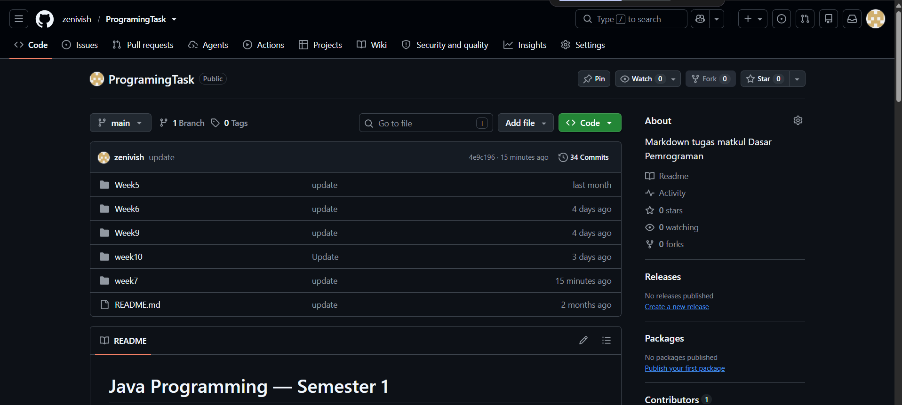
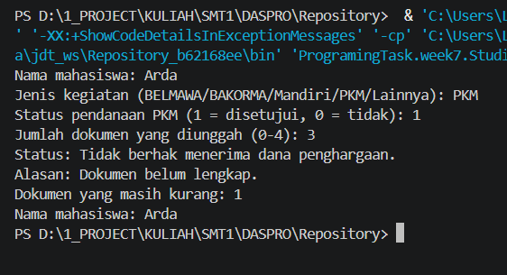

# JOBSHEET 6 - CASE STUDY: SELECTION STRUCTURES WITH GIT AND GITHUB

**Student Information:**

* **Name:** Mohammad Wisnu
* **Student ID:** 264107020193
* **Class / Attendance No.:** TI 1I / 20

---

## 1: PRACTICAL OBJECTIVES

The objectives of this practical session are:

1. Students are able to solve case studies using basic and nested selection structures.
2. Students are able to save and submit their work using Git and GitHub through Visual Studio Code.
3. Students are able to collaborate with classmates using GitHub.

---

## 2: EXPERIMENT RESULTS AND ANALYSIS

### 2.1 Experiment 1: Setting Up a Repository

This experiment creates a GitHub repository, clones it to the computer using VS Code, and saves student identity information in a README file.

#### 2.1.1 Repository Information

* **Repository name:** `ProgramingTask`
* **Visibility:** Public
* **Repository URL:** https://github.com/zenivish/ProgramingTask

#### 2.1.2 Setup Evidence / Screenshot



#### 2.1.3 Setup Notes

* Git identity (`user.name` and `user.email`) was configured in VS Code terminal.
* The repository was cloned from GitHub.
* A README file containing student identity information was created, committed, and pushed.

---

### 2.2 Experiment 2: Case Study 1 – Basic Selection

Senja Coffee Shop sells Palm Sugar Milk Coffee for Rp18,000 per cup. A 10% discount is given when the purchase total is at least Rp100,000. The cashier program calculates the purchase total, discount, payment, and change.

#### 2.2.1 Java Program Code

```java
import java.util.Scanner;

public class StudiKasus120 {
    public static void main(String[] args) {
        Scanner input = new Scanner(System.in);

        final int HARGA_KOPI = 18000;
        int jumlah;
        int total;
        double diskon = 0;
        double totalBayar;
        double uangBayar;
        double kembalian;

        System.out.print("Jumlah kopi yang dibeli: ");
        jumlah = input.nextInt();

        total = jumlah * HARGA_KOPI;

        if (total >= 100000) {
            diskon = total * 0.10;
        }

        totalBayar = total - diskon;

        System.out.println("Total harga: Rp" + total);
        System.out.println("Diskon: Rp" + diskon);
        System.out.println("Total pembayaran: Rp" + totalBayar);

        System.out.print("Uang yang dibayarkan: Rp");
        uangBayar = input.nextDouble();

        kembalian = uangBayar - totalBayar;
        System.out.println("Kembalian: Rp" + kembalian);

        input.close();
    }
}
```

#### 2.2.2 Program Output / Screenshot



#### 2.2.3 Answers to Questions / Reflection Questions

* **Question 1:** What is the purpose of the selection structure in this cashier program?
  * **Answer:** The selection structure checks whether the purchase total reaches Rp100,000. If it does, the program applies a 10% discount; otherwise, no discount is applied.

* **Question 2:** When is the discount applied?
  * **Answer:** The discount is applied when the purchase total is at least Rp100,000, including exactly Rp100,000.

* **Question 3:** What information is needed to calculate the change?
  * **Answer:** The program needs the amount paid by the customer and the final payment after the discount. The change is the amount paid minus the final payment.

#### 2.2.4 Git Commit Evidence

* **Commit 1:** `SK1: input and variable declaration`
* **Commit 2:** `SK1: discount and change logic`

<!--
Insert a screenshot of the commit history or Source Control panel showing at least two clear commits.
Suggested filename: images/experiment2_commits.png
-->


---

### 2.3 Experiment 3: Case Study 2 – Nested Selection

This program checks whether a student is eligible to receive award funds. Eligibility depends on the activity type, competition rank or PKM funding status, and whether all four required documents have been uploaded.

The four required documents are the Assignment Letter, Certificate, Activity Photo, and Activity Poster. If an otherwise eligible student has fewer than four documents, the award is not given and the program reports the number of missing documents.

#### 2.3.1 Java Program Code

```java
import java.util.Scanner;

public class StudiKasus220 {
    public static void main(String[] args) {
        Scanner input = new Scanner(System.in);

        String nama;
        String jenisKegiatan;
        int jumlahDokumen;
        int peringkat = 0;
        int statusPKM = 0;
        int dokumenKurang;
        boolean memenuhiSyarat = false;
        String alasan;

        System.out.print("Nama mahasiswa: ");
        nama = input.nextLine();

        System.out.print("Jenis kegiatan (BELMAWA/BAKORMA/Mandiri/PKM/Lainnya): ");
        jenisKegiatan = input.nextLine().trim().toLowerCase();

        if (jenisKegiatan.equals("belmawa")
                || jenisKegiatan.equals("bakorma")
                || jenisKegiatan.equals("mandiri")) {
            System.out.print("Peringkat (1, 2, 3; 0 jika bukan juara): ");
            peringkat = input.nextInt();

            if (peringkat >= 1 && peringkat <= 3) {
                memenuhiSyarat = true;
                alasan = "Memenuhi syarat peringkat kompetisi.";
            } else {
                alasan = "Tidak memenuhi syarat: hanya juara 1, 2, atau 3.";
            }

        } else if (jenisKegiatan.equals("pkm")) {
            System.out.print("Status pendanaan PKM (1 = disetujui, 0 = tidak): ");
            statusPKM = input.nextInt();

            if (statusPKM == 1) {
                memenuhiSyarat = true;
                alasan = "Proposal PKM disetujui untuk pendanaan.";
            } else {
                alasan = "Proposal PKM tidak disetujui untuk pendanaan.";
            }

        } else {
            alasan = "Jenis kegiatan tidak termasuk dalam ketentuan.";
        }

        if (memenuhiSyarat) {
            System.out.print("Jumlah dokumen yang diunggah (0-4): ");
            jumlahDokumen = input.nextInt();

            if (jumlahDokumen >= 4) {
                System.out.println("Status: Berhak menerima dana penghargaan.");
                System.out.println("Alasan: " + alasan);
            } else {
                dokumenKurang = 4 - jumlahDokumen;
                System.out.println("Status: Tidak berhak menerima dana penghargaan.");
                System.out.println("Alasan: Dokumen belum lengkap.");
                System.out.println("Dokumen yang masih kurang: " + dokumenKurang);
            }
        } else {
            System.out.println("Status: Tidak berhak menerima dana penghargaan.");
            System.out.println("Alasan: " + alasan);
        }

        System.out.println("Nama mahasiswa: " + nama);
        input.close();
    }
}
```

#### 2.3.2 Program Output / Screenshot


#### 2.3.3 Answers to Questions / Reflection Questions

* **Question 1:** Which competition ranks qualify for award funds?
  * **Answer:** Only 1st, 2nd, and 3rd place qualify. Honorable Mention and regular participation do not qualify.

* **Question 2:** What is the requirement for a PKM team to qualify?
  * **Answer:** The PKM proposal must be approved for funding.

* **Question 3:** What happens when fewer than four required documents are uploaded?
  * **Answer:** The documents are considered incomplete, no award funds are given, and the program reports how many documents are missing.

* **Question 4:** How many documents are required, and what are they?
  * **Answer:** Four documents are required: Assignment Letter, Certificate, Activity Photo, and Activity Poster.

* **Question 5:** Why should the program ask only for the data needed for each activity type?
  * **Answer:** It avoids asking irrelevant questions. Competition activities need a rank, PKM needs a funding status, and other activities need neither.

#### 2.3.4 Git Commit Evidence

* **Commit 1:** `SK2: competition branch`
* **Commit 2:** `SK2: PKM and other branches`

<!--
Insert a screenshot showing at least two meaningful commits for Case Study 2.
Suggested filename: images/experiment3_commits.png
-->


---

### 2.4 Experiment 4: Cross-Testing a Classmate's Program

This activity is completed in pairs. One student tests the other student's Case Study 2 program, and then the students switch roles. The repository owner adds the classmate as a collaborator. The invited student accepts the invitation, clones the repository, runs at least three test cases, and records the results in the repository README.

#### 2.4.1 Cross-Testing Evidence / Screenshot

<!--
This activity requires another student's GitHub account and repository access.
After completing the collaboration steps, insert screenshots showing the collaborator invitation,
the test run, and/or the commit history.
Suggested filename: images/experiment4.png
-->


#### 2.4.2 Test Results

<!--
Replace the sample rows below with the actual results from testing your classmate's program.
Do not claim a test passed unless you have run it and checked the output.
-->

**Test Results for Case Study 2 by [Classmate Name]**

| No. | Activity Type | Documents | Rank / Funding | Actual Output | Correct? |
|---:|---|---:|---|---|---|
| 1 | BAKORMA | 3 | Rank 1 | [Enter observed output] | [Yes/No] |
| 2 | Mandiri | 4 | Rank 0 | [Enter observed output] | [Yes/No] |
| 3 | PKM | 4 | Approved (1) | [Enter observed output] | [Yes/No] |
| 4 | Lainnya | 4 | Not requested | [Enter observed output] | [Yes/No] |

#### 2.4.3 Cross-Testing Procedure

1. The repository owner opens the repository on GitHub and goes to **Settings → Collaborators**.
2. The owner adds the classmate using their GitHub username.
3. The invited student accepts the invitation sent by GitHub.
4. The invited student copies the repository HTTPS URL and clones it in VS Code.
5. Before editing, the invited student uses **Pull** to get the latest version.
6. The invited student runs `StudiKasus2<NoPresensi>.java` using at least three test cases.
7. The test results are added to the bottom of the repository's `README.md`.
8. The invited student stages the changes, commits with a clear message, and pushes them to GitHub.
9. The repository owner pulls the changes and checks the test results.
10. The owner checks the repository's **Commits** page to verify that the classmate's commit appears.

#### 2.4.4 Collaboration Notes

* **Classmate's name:** [Muhamad Dzaky Ammar Naufal]
* **Classmate's GitHub username:** [Fill in]
* **Classmate's repository URL:** [Paste URL]
* **Commit message used for test results:** `Test results for SK2 by [Name]`

---

## 3: CONCLUSION

In this jobsheet, I practiced using basic and nested selection structures in Java to solve case studies. The first case study applies a conditional discount and calculates the final payment and change. The second case study uses nested IF statements to determine award eligibility based on activity type, competition rank or PKM funding status, and document completeness.

I also practiced using Git and GitHub through VS Code to create a repository, clone it, stage changes, commit versions, and push work to GitHub. Through cross-testing, I learned how repository collaboration allows classmates to test each other's programs and share test results. The collaboration and screenshot sections must be completed using actual repository activity and evidence.

---

## APPENDIX: GITHUB COLLABORATION GUIDE

### A. Add a Classmate as a Collaborator (Repository Owner)

1. Open your repository on GitHub.
2. Select **Settings**.
3. Open **Collaborators** (the menu wording may vary slightly).
4. Click **Add people**.
5. Enter your classmate's GitHub username and send the invitation.
6. Ask your classmate to accept the invitation from GitHub/email.

### B. Accept the Invitation and Clone (Invited Student)

1. Open the GitHub invitation and click **Accept invitation**.
2. Open the repository shared by your classmate.
3. Click **Code → HTTPS → Copy URL**.
4. Open VS Code and choose **Clone Git Repository**.
5. Paste the copied URL, select a destination folder, and open the cloned repository.
6. If prompted, select **Yes, I trust the authors**.

### C. Run the Program and Record Tests

1. Open `StudiKasus2<NoPresensi>.java`.
2. Run the program using at least three different test cases.
3. Compare each actual output with the expected result.
4. Add the test table in section 2.4.2 to the bottom of the repository's README.
5. Save the file.

### D. Commit and Push the Test Results in VS Code

1. Open **Source Control** in the left sidebar.
2. Click the **+** beside `README.md` to stage the change.
3. Enter a commit message, for example: `Test results for SK2 by Wisnu`.
4. Click **Commit**.
5. Click **... → Push**, or **Sync Changes** if available.
6. Tell the repository owner that the test results have been pushed.

### E. Pull the Classmate's Changes (Repository Owner)

1. Open your repository in VS Code.
2. Click **... → Pull** in Source Control, or use **Sync Changes**.
3. Open `README.md` and confirm the test results are present.
4. Check the **Commits** page on GitHub to verify the classmate's commit.
5. If a test reveals an error, fix the program, commit the correction, and push it.

**Important:** Always pull before editing a shared repository. If both people edit the same README before pulling, Git may report a merge conflict. If a conflict appears, keep the required information from both versions, save the resolved file, then commit and push the resolution.
